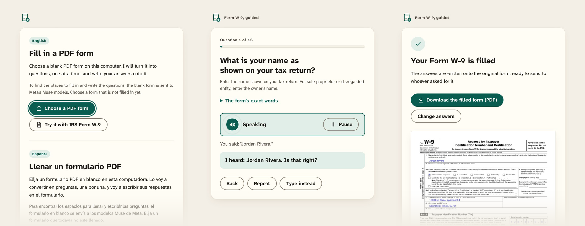
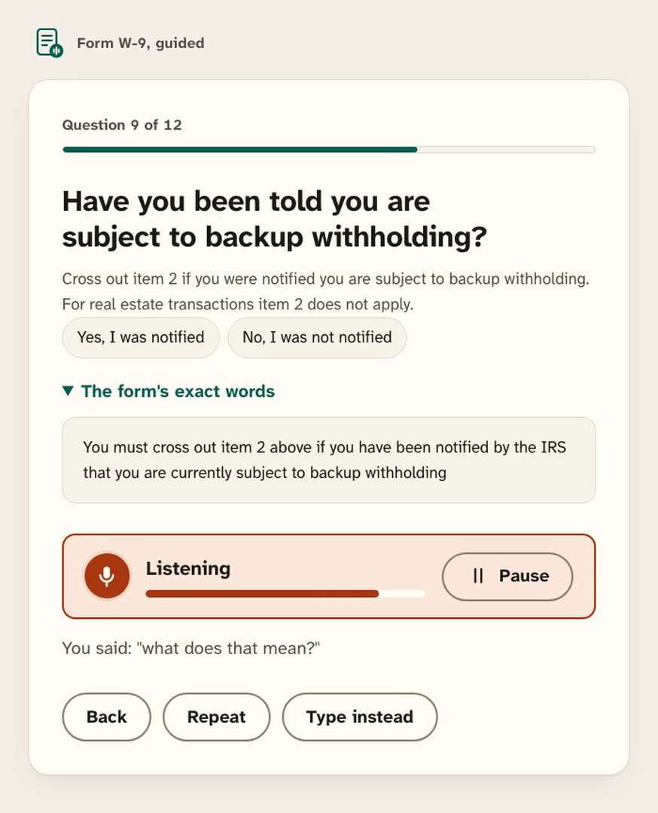
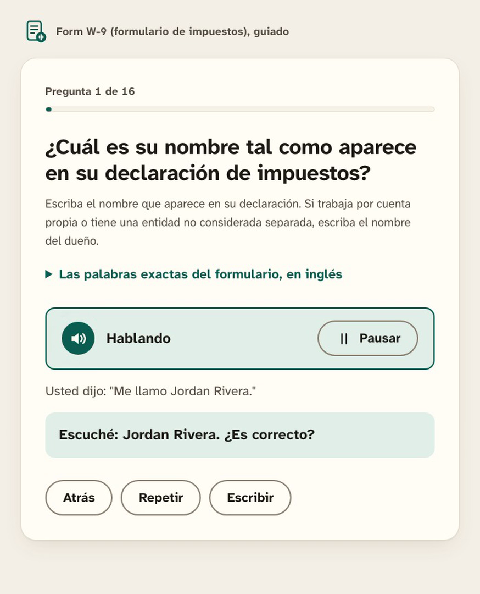
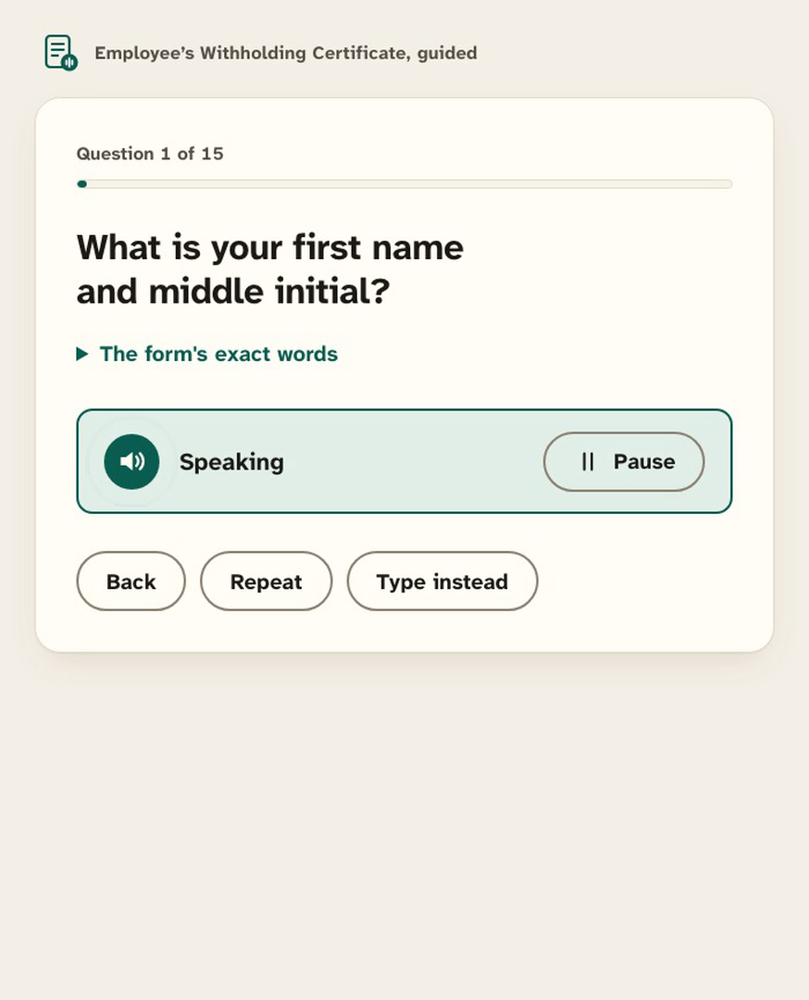
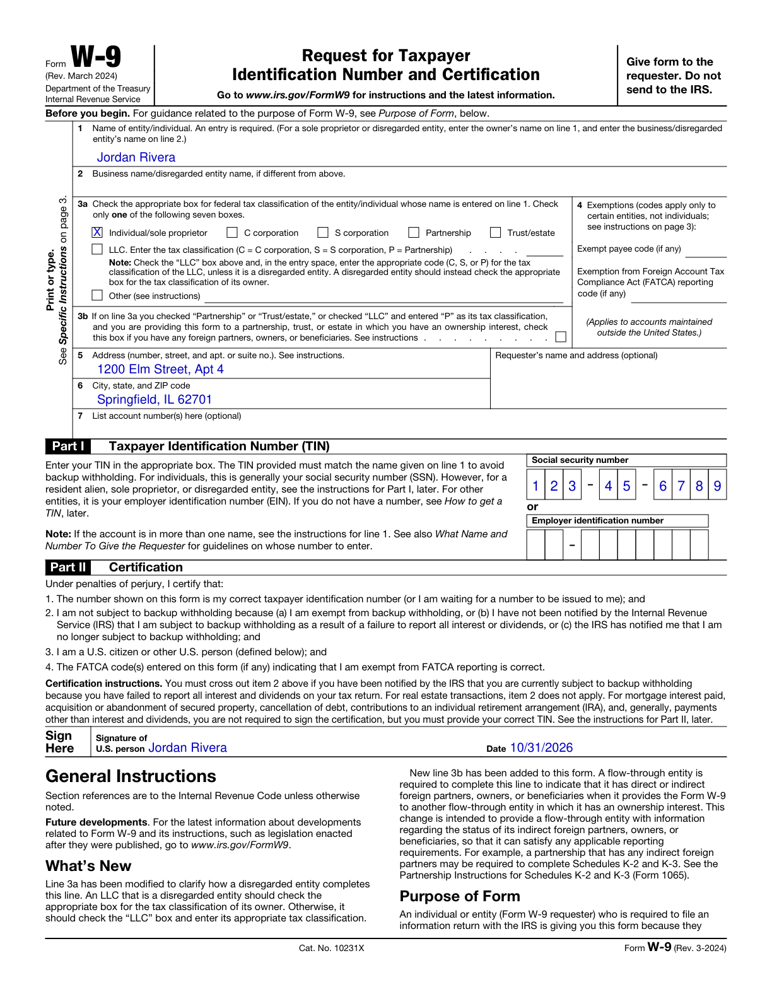
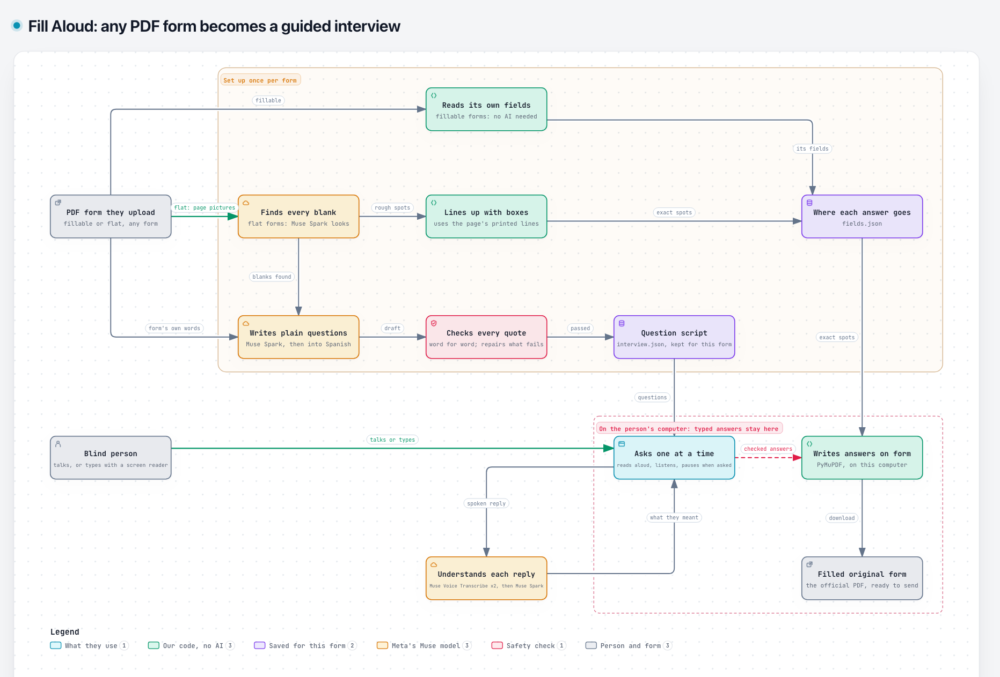

# Fill Aloud

**Fill in any PDF form by talking.**
Fill Aloud turns a PDF form that a screen reader can't fill into a short spoken interview, then writes the answers onto the original form.

[](LICENSE)
[](src/pyproject.toml)
[](#how-it-uses-metas-models)
[](https://cerebralvalley.ai/e/meta-ai-developer-hackathon)



Built for the **[Meta Global AI Developer Hackathon 2026](https://cerebralvalley.ai/e/meta-ai-developer-hackathon)**, Indie developer track, with Meta's **Muse Spark** and **Muse Voice Transcribe**.

## The problem

Blind people are sent PDF forms all the time: tax forms, leases, medical intake.
Most are flat pages with no fields a screen reader can use, or fields with no labels it can find.
Today the workaround is a sighted helper, or pasting the form into a chatbot that sends the answers away and checks nothing.
As one person put it on r/Blind in October 2026: "Can we enter signatures on pdf forms either in adobe acrobat reader or using markup in ios? Or do we still need sighted help."

## What it does

1. **Takes any PDF form.** Upload one on the start page, or try the sample IRS W-9. A fillable form's own fields are used as they are; on a flat form, Muse Spark finds the blanks.
2. **Asks one question at a time, in plain words.** Only the questions that apply are asked: on the W-9, an individual never hears the exemption questions meant for companies.
3. **Listens, and reads every answer back.** "I heard: Jordan Rivera. Is that right?" Nothing counts until the person says yes, because a blind person can't see a typo.
4. **Quotes the form when asked.** Say "What does that mean?" and it explains, then reads the form's exact words.
5. **Writes the answers onto the original PDF.** The person downloads the official form, filled in, one digit per box.

It speaks English and Spanish.
In screen-reader mode the person types instead of talking, and answers never leave their computer.
At any time they can say "pause", "repeat", "go back" or "skip".

## Demo

| Hear the form's own words | En español | A form it has never seen |
| --- | --- | --- |
|  |  |  |

The filled W-9, written onto the original IRS form:



The demo video, made from recordings of the real app, is described in [docs/demo-video.md](docs/demo-video.md).

## How it uses Meta's models

| Model | What it does here | Where |
| --- | --- | --- |
| **Muse Spark** | Looks at each page of a flat form and names every blank; our code then lines each one up with the box printed on the page | [`src/spike.py`](src/spike.py), [`src/forms.py`](src/forms.py) |
| **Muse Spark** | Writes the plain-language questions from the form and its instructions, and translates them into Spanish; our code checks that every quote matches the form word for word | [`src/interview.py`](src/interview.py), [`src/translate.py`](src/translate.py) |
| **Muse Voice Transcribe** | Hears each spoken reply, twice at once, so two independent hearings can be compared | [`src/voice.py`](src/voice.py) |
| **Muse Spark** | Decides what the person meant: an answer, "yes", "go back", "what does that mean?" | [`src/voice.py`](src/voice.py) |

Each model's output is checked by code before anyone relies on it: blanks are snapped to printed lines, quotes are compared with the form's text, and digits two hearings disagree on are asked again rather than guessed.

## How it works



The interactive diagram is [`architecture/architecture.html`](architecture/architecture.html); the full design, with every decision and its reason, is [`docs/design.md`](docs/design.md).

## What is proven, and what is not

- **Proven:** on the flat IRS W-9, Muse Spark plus our lining up places 23 of 23 fields (Muse alone 15 of 23), shown by [`src/spike.py`](src/spike.py) and `src/out/report.json`.
- **Proven:** every quote in the W-9 interview, and the full certification, is word for word in the form, shown by [`src/interview.py`](src/interview.py) (0 problems).
- **Proven:** individuals skip the exemption questions, and "yes" to backup withholding crosses out certification item 2, shown by [`src/e2e.py`](src/e2e.py).
- **Proven:** the W-9 fills end to end by keyboard only, and by recorded speech in English and Spanish with pause and resume, shown by [`src/e2e.py`](src/e2e.py) and [`src/e2e_voice.py`](src/e2e_voice.py).
- **Proven:** upload works on three forms (W-9 fillable, W-4 fillable, W-4 made flat), every answer on the returned PDF, shown by [`src/e2e_upload.py`](src/e2e_upload.py).
- **Proven:** on recordings of 10 accented speakers, transcribing each reply twice cut word errors from 10.3% to 4.1%, shown by [`src/accents.py`](src/accents.py) ([research note](docs/research/02-voice-and-languages.md)).
- **Not proven yet:** that blind users can finish a form with it without sighted help, or prefer it to a labelled form.
- **Not proven yet:** real flat forms beyond the W-4, scanned forms, and a real microphone in a noisy room.
- **Next:** 3 screen-reader users each fill the W-9, once by voice and once with their own screen reader.

We don't claim that it helps blind users, that it works on any PDF or on scans, that spoken answers stay private (they go to Meta to be understood), or that a typed name is a legal signature everywhere.

## Privacy

- Typed answers never leave the computer: the page, the server and the PDF writing all run locally.
- Spoken replies go to Meta's Muse Voice Transcribe and Muse Spark to be understood, and the page says so before the microphone turns on.
- Questions are read aloud by the computer's own voices.
- An uploaded form, not yet filled in, is sent to Muse Spark once to find its blanks and write its questions.

## Run it

You need [uv](https://docs.astral.sh/uv/) and a Meta Model API key, either in `~/meta.key` (readable only by you: `chmod 600 ~/meta.key`) or in the `MODEL_API_KEY` environment variable.
The key is never stored in this repository.

```sh
cd src
uv run serve.py
```

Then open http://127.0.0.1:4420 in Chrome or Safari, choose a PDF form or try the sample W-9, put on headphones, and press Enter to start talking (or choose screen-reader mode).
In voice mode, press Pause, Escape, or say "pause" at any time; Continue picks up at the same question with the answers kept.

### Tests

| Command | What it checks |
| --- | --- |
| `uv run e2e.py` | Answers every W-9 question by keyboard only and checks the filled PDF |
| `uv run e2e_voice.py` | Answers every question by recorded speech, in English and Spanish, checks the downloaded PDF, and checks pausing |
| `uv run e2e_upload.py input/fw9.pdf input/dl/fw4.pdf input/dl/fw4-flat.pdf` | Uploads each form, answers by keyboard, and checks every answer is on the PDF |

### Cost

The W-9's set-up outputs are cached in `src/out/`, so the sample makes no set-up calls.
Preparing a new form costs about $0.12 for a fillable 50-field form and about $0.20 for a flat one; its Spanish costs about $0.02 the first time someone picks Spanish.
Each spoken reply costs about $0.002.
An uploaded form is prepared once and kept in `src/out/forms/<id>/`, where the id is the start of the file's SHA-256, so the same form opens at once next time.

### Debugging the microphone

If voice mode mishears your microphone, run the server as `VOICE_DEBUG=out/debug uv run serve.py`.
It keeps each spoken reply as a WAV with what was heard, on this computer only, so the recording can be checked; delete the folder afterwards.

## Repository layout

| Path | What it is |
| --- | --- |
| [`src/serve.py`](src/serve.py) | Serves the start page and interviews, prepares uploads in the background, hears spoken replies, fills the PDF |
| [`src/web/interview.html`](src/web/interview.html) | The whole interface: voice mode and screen-reader mode, in one page |
| [`src/forms.py`](src/forms.py) | Prepares an uploaded PDF: reads its fields or finds its blanks, writes and repairs the interview |
| [`src/spike.py`](src/spike.py) | The W-9 proof: finds and lines up its blanks and scores them against the real fields |
| [`src/interview.py`](src/interview.py) | Writes the interview and checks every quote against the form |
| [`src/translate.py`](src/translate.py) | Translates the interview and the spoken phrases |
| [`src/voice.py`](src/voice.py) | Hears one spoken reply: transcribe twice at once, then understand |
| [`src/accents.py`](src/accents.py) | Measures transcription on 12 accented speakers from the Speech Accent Archive |
| [`src/record_demo.py`](src/record_demo.py), [`src/edit_demo.py`](src/edit_demo.py) | Record the real app and cut the demo video ([docs/demo-video.md](docs/demo-video.md)) |
| [`docs/research/`](docs/research/) | Who is blocked and why, the closest products, and voice and language research |

The page uses Atkinson Hyperlegible Next, a typeface the Braille Institute drew so low-vision readers can tell letters apart, served from `src/web/fonts/` so the page loads nothing from other sites.

## Pages

- [Labelled W-9 form](src/out/form.html): every blank Muse Spark found on the flat W-9, as a labelled input.

## License

The code is under the GNU Affero General Public License v3.0 ([`LICENSE`](LICENSE)), because it uses [PyMuPDF](https://pymupdf.readthedocs.io/), which is AGPL-3.0.
The Atkinson Hyperlegible Next font is under the SIL Open Font License 1.1 ([`src/web/fonts/OFL.txt`](src/web/fonts/OFL.txt)).
The IRS forms in `src/input/` are US government works, in the public domain.
Every answer shown here (Jordan Rivera, 123-45-6789) is made up.
